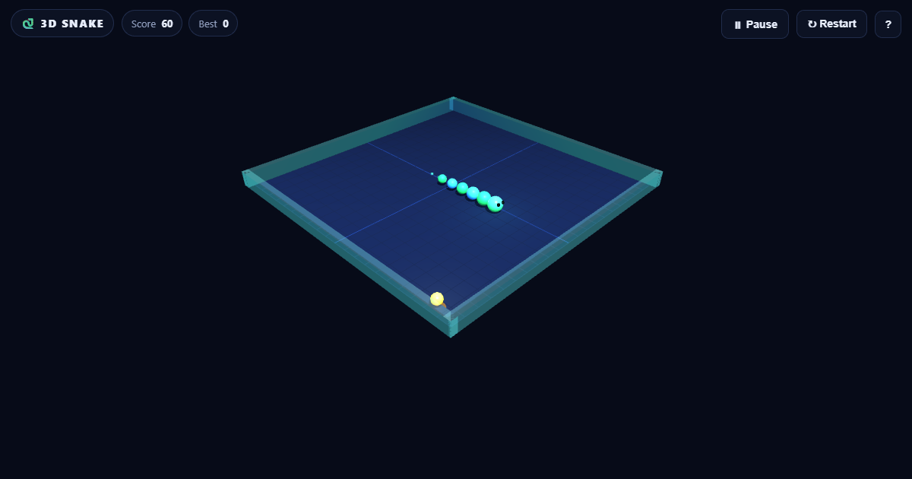

# 3D Snake

A 3D snake game for the browser, with an automatic 2D fallback when WebGL is
missing. Eat orbs, climb an uncapped, shrinking-window combo ladder, bank hot
streaks, level through 8 arena biomes and chase the daily challenge — playable
offline as a PWA.

**Live:** <https://serpentia-coral.vercel.app/> · **Repo:** <https://github.com/LightningJake/serpentia>



## Run it

No build step, no runtime dependencies. The deployed site is a plain static bundle.

```sh
npm ci          # install dev/test tooling (playwright-core, prettier)
npm run serve   # http://localhost:8080
```

Open the page. Over `file://` everything works except the service worker and PWA
install prompts — use `npm run serve` for those.

## How to play

- Click/tap the board to steer toward it, or turn with `←` / `A` / `→` / `D`,
  swipe on touch, or the on-screen `◀ ▶` buttons (`↑` / `W` intentionally do
  nothing).
- The snake always moves forward. Every 6 foods levels up; each level brings a
  new biome: Meadow → Desert → Ocean → Volcano → Space → Forest → Sunset → Ice.
- Chained eats climb the **combo ladder**. Chained within the window to the next
  eat raises the multiplier with no ceiling, but the window shrinks every step —
  so a long chain is a bet. Pause and **bank** a 5+ chain for a guaranteed
  lump sum; crash with one un-banked and it dies with the run.
- Pink **bonus orbs** score 50 × combo; cyan **shield orbs** survive one crash;
  fences and obstacles appear from level 2 in Obstacles mode; Ice slides,
  Desert food withers, Volcano embers telegraph then burn.
- At level 2+, dying offers **⭐ Prestige**: restart with a permanent +10% score
  bonus (stacks).
- **Daily challenge**: the same map and rule for everyone, seeded per UTC day.
  Streaks are tracked locally.

## Deep links

Share or bookmark a configuration:

```
?theme=volcano      start in a biome by name (meadow … ice)
?seed=7             deterministic map + spawns (seed replayable URL)
?daily=            today's daily challenge; ?daily=<day> replays a specific day
?lang=en|es|fr|de  force a language (default: browser, falls back to en)
```

Example: [`.../?theme=volcano&seed=7`](https://serpentia-coral.vercel.app/?theme=volcano&seed=7)
replays the same arena with the same spawns for anyone.

## Development

```sh
npm run test:unit        # pure logic (logic.js) in plain node
npm run test:scan        # static cross-checks: ids, i18n coverage, SW assets, hooks
npm run test:contrast    # WCAG-style palette audit vs biome grounds
npm run test:sw-version  # fails if shipped assets change without a SW cache bump
npm test                 # desktop e2e (real browser; exits non-zero on failure)
npm run test:mobile      # mobile viewport e2e
npm run test:edge        # Edge e2e
npm run test:resolutions # 9 viewports × full reloads
npm run test:perf        # boot + frame perf budgets
npm run test:all         # everything, in order
npm run format:check     # prettier (CI gate)
```

The e2e suites drive a Chromium-family browser. Locally they default to Edge
(Windows); override with `PW_CHANNEL=chrome` or `PW_EXECUTABLE=/path/to/browser`.
CI (`.github/workflows/e2e.yml`) runs the unit/scan/contrast/sw-version jobs and
all e2e jobs on `ubuntu-latest` with Chrome, on pushes and PRs.
On any failure the suite clears out non-zero — do not merge red.

## Layout

| Path            | Purpose                                                          |
| --------------- | ---------------------------------------------------------------- |
| `index.html`    | Markup, inline hydration scripts, help content                   |
| `main.js`       | The game: rendering (Three.js r149 UMD + 2D canvas fallback),    |
|                 | input, HUD, settings, PWA wiring, i18n boot                      |
| `logic.js`      | Pure game logic — no DOM/THREE; required by e2e and test/unit    |
| `style.css`     | All styling; game palettes also live in `main.js` (contrast      |
|                 | test reads it)                                                   |
| `i18n.js`       | en/es/fr/de dictionaries (en is the fallback)                    |
| `sw.js`         | Service worker: versioned precache, network-first for app assets |
| `manifest.json` | PWA install metadata (192/512 + maskable icons)                  |
| `test/`         | node-only unit + static checks                                   |
| `e2e/`          | Playwright-based end-to-end suites                               |

## Making changes

- **Ship or modify anything a browser caches?** Bump `CACHE` in `sw.js` (the
  `snake-vN` constant). `npm run test:sw-version` enforces this and tells you
  the exact value to set.
- **Add/change a user-facing string?** Add the key to `i18n.js` for all four
  languages (en is mandatory — it is the fallback), then `npm run test:scan`
  checks every `t('key')` and every HTML `data-i18n*` fallback against the en
  dictionary.
- **Add a language?** Copy the `en` block in `i18n.js`, add the code to
  `LANGS` in `main.js`, and extend the `(en|es|fr|de)` regex pair in
  `test/scan.js` — then bump the SW cache.
- **Game rules?** Keep new logic pure in `logic.js` where possible and covered
  by `test/unit.js`; the e2e hooks live on `window.__game` in `main.js`.
- **Style:** `npm run format` before committing; `.prettierrc` pins the rules.
- **Storage:** everything the game saves lives under `snake3d.*` in
  localStorage; the menu's "Erase all progress" wipes it.

## License

ISC — see `package.json`.
